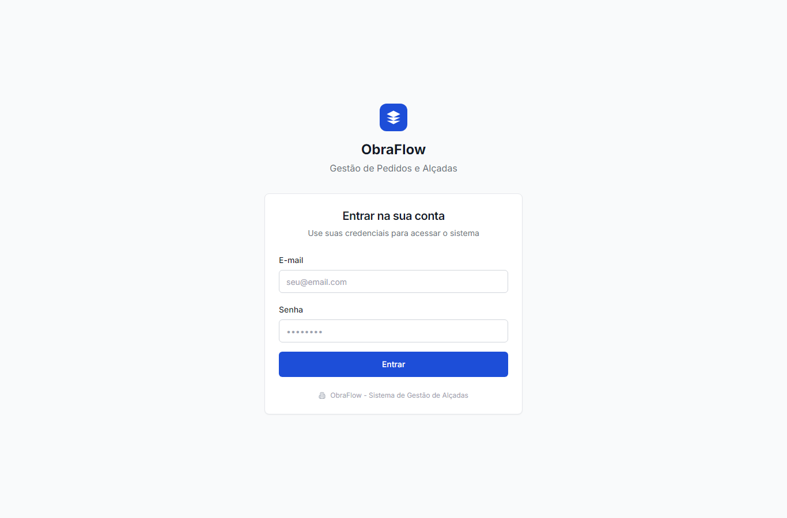
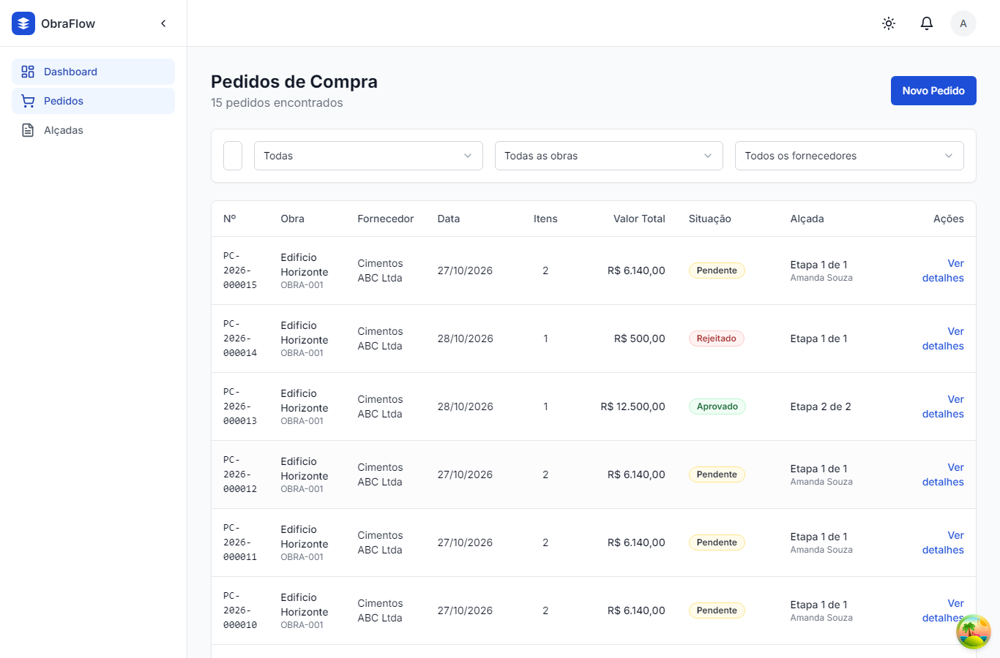
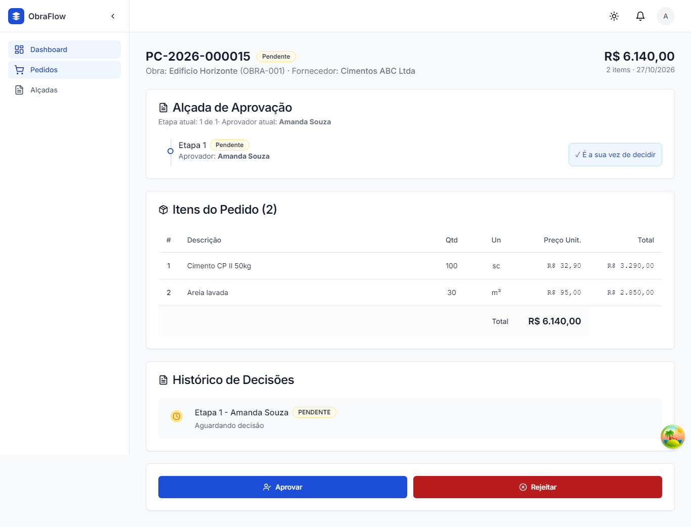
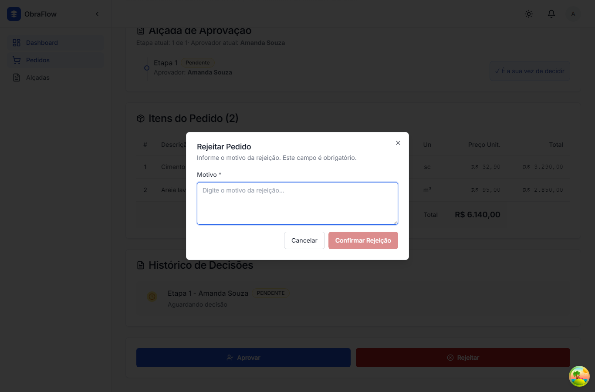
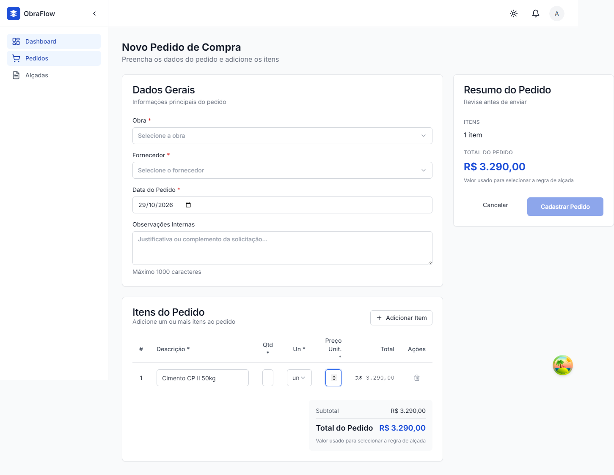
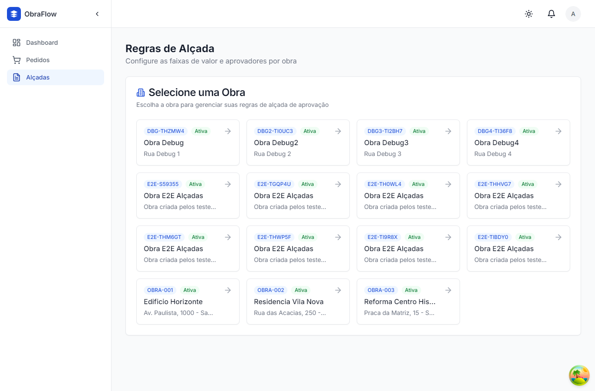
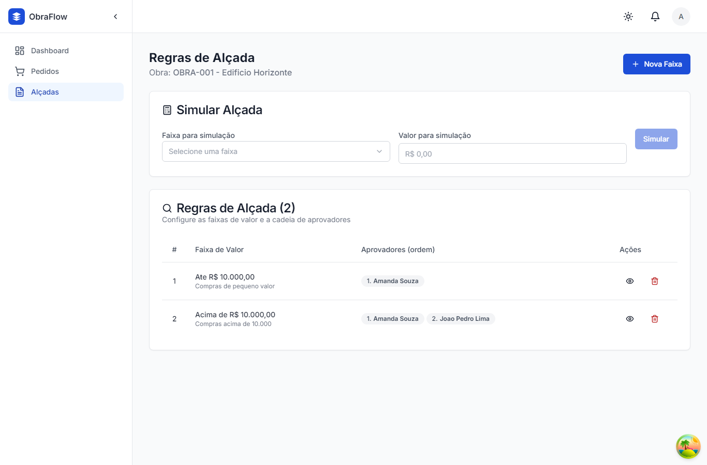
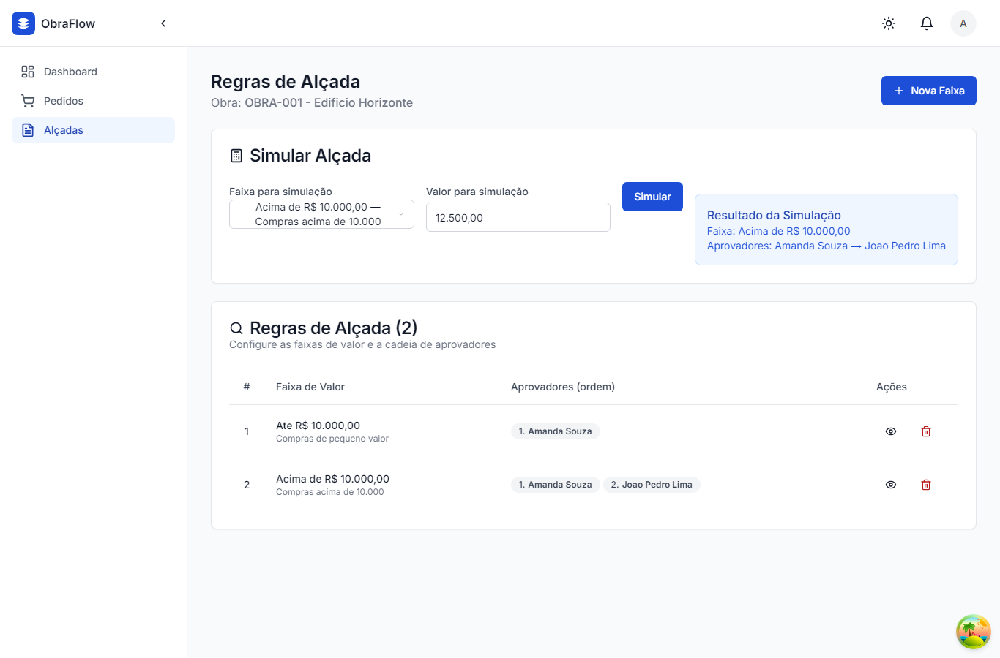
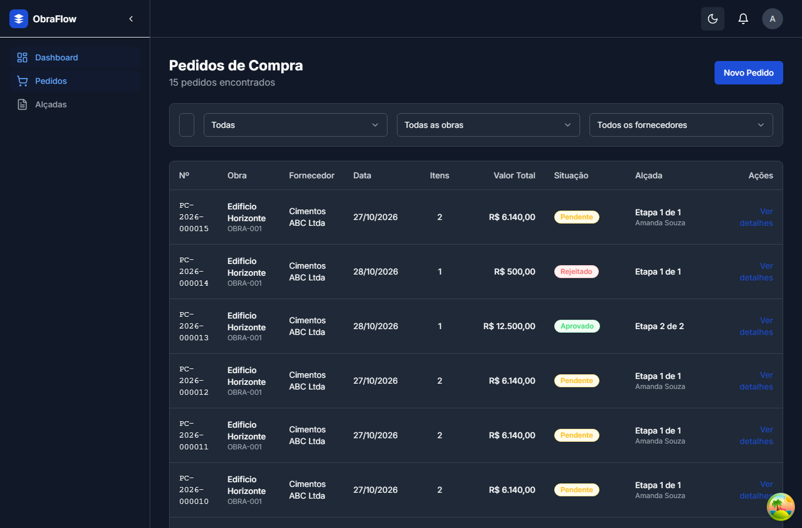
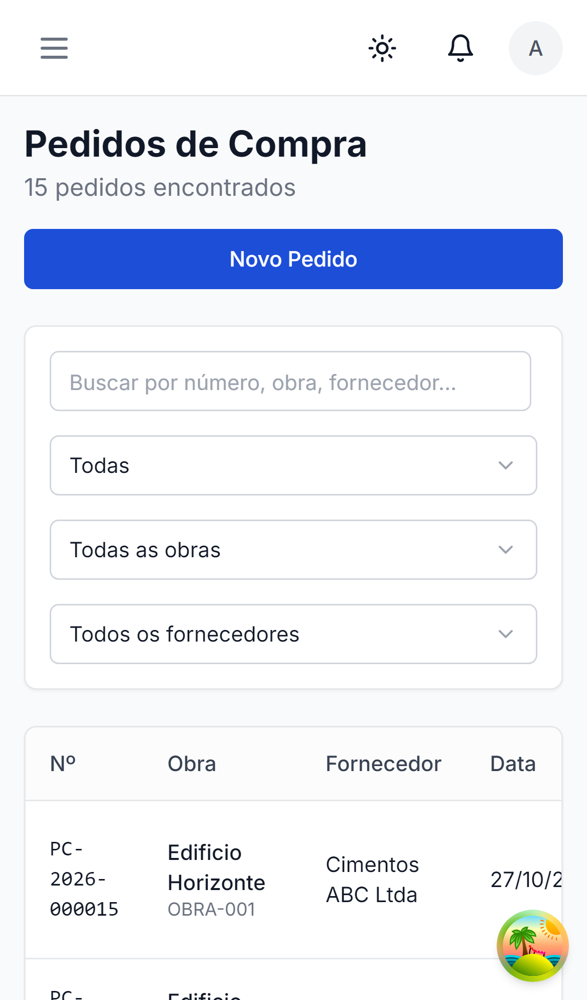

# ObraFlow — Sistema de Pedidos de Compra com Alçada de Aprovação


Plataforma full-stack para empresas do setor de construção civil. Gerencia pedidos de compra com fluxo de aprovação por alçada (regras que definem quem aprova e em que ordem, conforme a obra e o valor total do pedido).

## 📋 Sumário

- [Tecnologias](#tecnologias)
- [Decisões técnicas](#decisões-técnicas)
- [Como a regra de alçada é modelada, calculada e persistida](#regra-de-alçada)
- [Comunicação front-end ↔ back-end](#comunicação-front-end--back-end)
- [Consistência e integridade dos dados](#consistência-e-integridade)
- [Como executar localmente](#como-executar-localmente)
- [Como rodar os testes](#como-rodar-os-testes)
- [Dados de demonstração](#dados-de-demonstração)
- [Endpoints da API](#endpoints-da-api)
- [O que mudaria em produção](#o-que-mudaria-em-produção)
- [Telas](#telas)

---

## 🛠 Tecnologias

### Back-end
- **Java 24 / Spring Boot 4.1.2** — framework da aplicação.
- **Arquitetura Hexagonal** — separação entre domínio (core), casos de uso (aplicação) e adaptadores (inbound HTTP / outbound persistência).
- **Spring Data JPA + Hibernate** — persistência relacional.
- **PostgreSQL 16+** — banco de dados (Docker Compose sobe `postgres:16-alpine`; funciona em versões mais novas, como a 18).
- **Flyway** — migrações versionadas (`V1__baseline.sql`, `V2__constraints.sql`, `V3__constraints_deferrable_aprovadores.sql`).
- **Spring Security + JWT** — autenticação e autorização baseada em papéis (`ADMIN`, `APROVADOR`, `COMPRADOR`).
- **SpringDoc OpenAPI 3** — documentação automática da API (`/v3/api-docs`, `/swagger-ui.html`).
- **Maven** — build e gerenciamento de dependências.
- **Testes:** JUnit 5 + assertions de domínio + testes de integração com banco embutido.

### Front-end
- **Next.js 14.2 (App Router)** — framework React com Server Components e Server Actions.
- **TypeScript** — tipagem estática.
- **Tailwind CSS** — estilização utilitária.
- **Shadcn/ui** — componentes de interface (button, dialog, table, select, etc.).
- **React Hook Form + Zod** — formulários e validação de esquema.
- **TanStack Query** — gerenciamento de estado remoto, cache e loading/erro.
- **next-auth (Credentials)** — autenticação JWT com sessão de 8h.
- **date-fns** — formatação de datas e moeda (locale pt-BR).
- **lucide-react** — ícones.
- **Vitest + Playwright** — testes unitários e E2E.

### Infraestrutura
- **Docker Compose** — orquestração de back-end, front-end e PostgreSQL.
- **GitHub Actions** — CI/CD e deploy.

---

## 🧠 Decisões técnicas

1. **Arquitetura hexagonal no back-end**: o domínio não conhece HTTP nem banco. Exceções de negócio (`RegraDeNegocioException`, `EntidadeNaoEncontradaException`, etc.) são traduzidas para respostas RFC 7807 (`ProblemDetail`) pelo `ErroGlobalHandler`. Isso facilita testar o domínio isoladamente e trocar adaptadores.

2. **Alçada materializada no pedido**: ao criar um pedido, o back-end já calcula a cadeia de aprovadores (com base na obra e valor total) e persiste as etapas (`EtapaAlcada`) vinculadas ao pedido. A lista de pendentes reflete o nível atual da alçada, calculado e persistido pelo back-end — não recalculado no front-end.

3. **Front-end com Server Actions**: mutações (criar/editar/deletar faixa, aprovar/rejeitar pedido) são feitas via Next.js Server Actions, que chamam a API do back-end com o token JWT da sessão. Leitura de listas usa TanStack Query com `cache: 'no-store'` e revalidação por tag (`revalidateTag`).

4. **Validação em duas camadas**: Zod no front-end (feedback imediato ao usuário) e Bean Validation (`@Valid`) + exceções de domínio no back-end (garantia de integridade mesmo que o front-end seja ignorado).

5. **NextAuth com estratégia JWT**: o `accessToken` do back-end é armazenado na sessão JWT e enviado no header `Authorization: Bearer` de cada requisição à API.

---

## 📐 Regra de alçada — modelagem, cálculo e persistência

### Modelagem
Uma **faixa de alçada** (`NivelAlcada`) pertence a uma obra e define:
- `limiteInferior` (inclusivo) e `limiteSuperior` (exclusivo, `null` = sem teto).
- Lista ordenada de aprovadores (`usuariosAprovadores`), na ordem do fluxo.

### Cálculo
Ao criar um pedido, o `ServicoAlcada`:
1. Soma o total dos itens (`quantidade × preçoUnitario`).
2. Busca a faixa da obra onde `limiteInferior <= valorTotal` e (`limiteSuperior` é `null` OU `valorTotal < limiteSuperior`).
3. Materializa as etapas de aprovação (`EtapaAlcada`) na ordem dos aprovadores da faixa, todas com situação `PENDENTE`.
4. Persiste o pedido com `etapaAtual = 1`, `totalEtapas = N` e a cadeia completa.

### Fluxo de decisão
- Somente o **aprovador da etapa corrente** (`situacao = PENDENTE`) pode decidir.
- `APROVADO` → avança para a próxima etapa; se não houver próxima, o pedido fica `APROVADO`.
- `REJEITADO` → exige `motivo` obrigatório, interrompe o fluxo e o pedido fica `REJEITADO`.
- Decisões fora de ordem são rejeitadas pelo back-end (`RegraDeNegocioException`).

### Valores sem regra aplicável
Se nenhum faixa cobrir o valor do pedido, o back-end impede a criação com erro claro (documentado na exceção de negócio).

---

## 🔌 Comunicação front-end ↔ back-end

O front-end consome a API REST do back-end através do módulo `src/lib/api.ts`:

- `BACKEND_URL` (default `http://localhost:8080`) → todas as requisições vão para `${BACKEND_URL}/api/v1{path}`.
- Autenticação: token JWT obtido no login (`/auth/login`) e incluído no header `Authorization: Bearer <token>`.
- Mutações usam Next.js Server Actions (`actions.ts`) que chamam `apiFetch` com o token da sessão.
- Listas usam TanStack Query (`useQuery`) com `cache: 'no-store'` para evitar dados obsoletos.

Exemplo de fluxo de criação de pedido:
1. Front-end envia `POST /api/v1/pedidos` com `{ obraId, fornecedorId, dataPedido, observacoes, itens[] }`.
2. Back-end calcula total, determina a alçada, retorna `PedidoResultado` com cadeia de etapas.
3. Front-end redireciona para `/pedidos` e recarrega a lista.

---

## 🛡 Consistência e integridade dos dados

- **Transações JPA**: criação de pedido e materialização da alçada ocorrem em uma única transação.
- **Controle de concorrência**: `OptimisticLockingFailureException` tratado com HTTP 409.
- **Integridade referencial**: remoção de faixa bloqueada se houver pedidos vinculados (`DataIntegrityViolationException` → HTTP 409).
- **Validação de domínio**: regras como "limite superior > limite inferior", "mínimo 1 aprovador", "motivo obrigatório na rejeição" são aplicadas no back-end.
- **Erro padronizado**: `ErroGlobalHandler` retorna `ProblemDetail` (RFC 7807) com status, título, tipo, detalhe e timestamp.

---

## ▶ Como executar localmente

### Pré-requisitos
- Java 17+ (back-end)
- Node.js 20+ (front-end)
- Docker e Docker Compose (opcional, para subir tudo de uma vez)

### Com Docker Compose (recomendado)

Na raiz do repositório:

```bash
docker-compose up --build
```

Isso sobe:
- PostgreSQL na porta `5432` (banco `obraflow`).
- Back-end na porta `8080`.
- Front-end na porta `3000`.

Acesse: `http://localhost:3000`

### Sem Docker (manual)

**Back-end:**
```bash
cd backend
./mvnw spring-boot:run
```
O back-end sobe em `http://localhost:8080` e roda as migrações Flyway + seed de dados de demonstração automaticamente.

**Front-end:**
```bash
cd frontend
cp .env.local.example .env.local  # confira BACKEND_URL=http://localhost:8080
npm install
npm run dev
```
O front-end sobe em `http://localhost:3000`.

### Variáveis de ambiente

`backend/src/main/resources/application.yml` (sobrescrevível por variáveis de ambiente):
```
spring.datasource.url=jdbc:postgresql://localhost:5432/obraflow
spring.datasource.username=obraflow
spring.datasource.password=obraflow
app.demo.enabled=true        # OBRAFLOW_DEMO_ENABLED
app.demo.senha-padrao=obraflow123  # OBRAFLOW_DEMO_SENHA
```

`frontend/.env.local`:
```
BACKEND_URL=http://localhost:8080
NEXTAUTH_URL=http://localhost:3000
NEXTAUTH_SECRET=obraflow-local-dev-secret-change-me-please-32bytes-min
```

---

## 🧪 Como rodar os testes

### Back-end (JUnit 5 + ArchUnit)

```bash
cd backend
./mvnw verify
```

Sobe um **PostgreSQL embutido** (zonky) por teste — não depende do banco local. Valida migrações Flyway, regras de negócio da alçada e a arquitetura hexagonal (ArchUnit).

### Front-end — testes unitários (Vitest)

```bash
cd frontend
npm test
```

Cobre componentes (formulário de pedido, simulador de alçada) com Testing Library.

### Front-end — testes E2E (Playwright, 32 testes)

```bash
cd frontend
npm run test:e2e
```

Pré-requisitos: back-end rodando em `:8080` (com seed de demonstração) e front-end em `:3000` (o Playwright reutiliza servidores existentes). A suíte sobe o Chromium e cobre, entre outros:

- **Login**: credenciais válidas/inválidas, validação de campos, logout.
- **Pedidos**: criação com N itens e totalização, validações, bloqueio quando não há regra de alçada para o valor.
- **Aprovação**: detalhes com itens/etapas/histórico, aprovação em cadeia (etapa 1 → 2 → 3), rejeição com motivo, bloqueio de decisão fora de ordem.
- **Alçadas**: CRUD completo de faixas (criar, editar/reordenar aprovadores, excluir), simulador, autorização (não-ADMIN redirecionado).
- **Estados de UI**: empty states, loading, tema claro/escuro, responsividade mobile.

---

## 🌱 Dados de demonstração

O `DemoDataSeeder` (back-end) carrega automaticamente (quando o banco está vazio):

- **7 usuários**: Amanda (ADMIN/APROVADOR), João (APROVADOR), Patricia (APROVADOR), Bruno (APROVADOR), Carlos (COMPRADOR), Rafael (COMPRADOR), Marcos (ADMIN).
- **3 obras**: Edifício Horizonte (OBRA-001), Residência Vila Nova (OBRA-002), Reforma Centro Histórico (OBRA-003).
- **6 faixas de alçada** distribuídas pelas obras.
- **3 fornecedores**.
- **6 pedidos** em diferentes estados: pendente (aguardando primeira decisão), pendente duplo (etapa 1 aprovada), aprovado (3 etapas), rejeitado (com motivo), e mais dois pendentes.

Credênciais de exemplo (senha: `obraflow123`, configurada em `app.demo.senha-padrao`):
- `carlos.menezes@obraflow.com.br` (Comprador)
- `amanda.souza@obraflow.com.br` (Aprovador/Admin)
- `joao.lima@obraflow.com.br` (Aprovador)

---

## 📡 Endpoints da API

Base: `http://localhost:8080/api/v1`

### Autenticação
| Método | Endpoint | Descrição |
|--------|----------|-----------|
| POST | `/auth/login` | Autentica e retorna `accessToken` |
| GET | `/auth/me` | Perfil do usuário autenticado |

### Obras
| Método | Endpoint | Descrição |
|--------|----------|-----------|
| GET | `/obras` | Lista obras |
| GET | `/obras/{id}` | Detalha uma obra |
| POST | `/obras` | Cadastra obra |

### Fornecedores
| Método | Endpoint | Descrição |
|--------|----------|-----------|
| GET | `/fornecedores` | Lista fornecedores |
| GET | `/fornecedores/{id}` | Detalha fornecedor |
| POST | `/fornecedores` | Cadastra fornecedor |

### Pedidos
| Método | Endpoint | Descrição |
|--------|----------|-----------|
| POST | `/pedidos` | Cria pedido (cabeçalho + N itens + alçada) |
| GET | `/pedidos` | Lista pedidos paginada com filtros |
| GET | `/pedidos/{id}` | Detalha pedido (itens + histórico da alçada) |
| POST | `/pedidos/{id}/decisoes` | Registra aprovação ou rejeição (motivo obrigatório em rejeição) |

### Alçadas
| Método | Endpoint | Descrição |
|--------|----------|-----------|
| GET | `/obras/{obraId}/niveis` | Lista faixas de alçada de uma obra |
| POST | `/obras/{obraId}/niveis` | Cadastra nova faixa |
| PUT | `/niveis/{nivelId}` | Atualiza faixa e aprovadores |
| DELETE | `/niveis/{nivelId}` | Remove faixa (bloqueada se houver pedidos vinculados) |
| GET | `/niveis/{nivelId}/simulacao?valor=X` | Simula cadeia de aprovação para um valor |

### Usuários
| Método | Endpoint | Descrição |
|--------|----------|-----------|
| GET | `/usuarios` | Lista usuários |

Documentação interativa: `http://localhost:8080/swagger-ui.html`

---

## 🚀 O que mudaria em produção

1. **Segurança**: substituir `next-auth` Credentials por provedor OAuth2/OIDC (ex: Keycloak, Auth0, Azure AD); cookie `secure` e `sameSite`; HTTPS obrigatório.
2. **Segredo**: `NEXTAUTH_SECRET` e senhas do banco via variáveis de ambiente/secrets manager, nunca no repositório.
3. **Banco**: PostgreSQL gerenciado com backups, conexão pooling ajustado e migrations executadas em pipeline de migração, não na inicialização da app.
4. **Observabilidade**: logs estruturados, métricas (Micrometer/Prometheus), tracing distribuído e health checks.
5. **Notificações**: substituir a lista hardcoded por um serviço real de notificação (e-mail, push, WebSocket) acionado por eventos de aprovação/rejeição.
6. **Cache**: Redis para cache de sessão e consultas frequentes; CDN para assets estáticos.
7. **Testes**: aumentar cobertura de testes de integração e contratos de API (Pact); testes de carga nos endpoints críticos.
8. **Resiliência**: circuit breaker e retry com backoff nas chamadas entre serviços; timeouts configurados.
9. **CI/CD**: pipeline com build, testes, análise estática (Sonar), scan de dependências e deploy em ambiente de staging antes da produção.

---

## 🖼 Telas

### Login (`/login`)



### Pedidos — lista (`/pedidos`)



### Pedidos — detalhe com alçada e histórico (`/pedidos/[id]`)



Aprovar/rejeitar aparece somente para o aprovador da etapa corrente; a rejeição exige motivo:



### Novo pedido (`/pedidos/novo`)

Formulário com obra, fornecedor e N itens; o botão "Cadastrar Pedido" só habilita quando o formulário é válido:



### Alçadas — seletor de obras (`/alcadas`)



### Alçadas — regras da obra (`/alcadas/[obraId]`)

CRUD de faixas com cadeia ordenada de aprovadores:



### Alçadas — simulador

Consulta a cadeia de aprovação que um valor específico dispararia:



### Modo escuro



### Responsividade mobile



---

## ✅ Critérios de avaliação (desafio)

| Critério | Status | Evidência |
|----------|--------|-----------|
| Funcionamento completo (front + back + persistência) | ✅ Implementado | Suíte E2E Playwright (32 testes) + `./mvnw verify` |
| Modelagem das regras de alçada | ✅ Implementado e persistido | Seção [Regra de alçada](#regra-de-alçada) + testes de CRUD/simulador de faixas |
| Qualidade de código / organização | ✅ Arquitetura hexagonal (back) + componentes organizados (front) | ArchUnit no `mvnw verify`; `tsc --noEmit` e ESLint limpos |
| Desenho de UI (hierarquia, clareza, consistência) | ✅ Layout consistente com Sidebar/Header, loading/empty/erro | Screenshots na seção [Telas](#telas); testes de estados de UI |
| Estados (loading / empty / erro), validações | ✅ loading.tsx, EmptyState, ErrorState, validação Zod + domínio | Testes E2E de empty state e validações; Vitest nos formulários |
| Documentação (Decisões técnicas) | ✅ Este README | — |

---

**Contato do desafio:** Jonathan Bispo — WhatsApp: +55 71 99204-4335 — E-mail: contrato@obraflow.io
